<!-- PStar80 portfolio: shared blue cybernetic visual language with the GitHub profile and SkyCommand public showcase. -->
<picture>
  <source media="(prefers-reduced-motion: reduce) and (max-width: 650px)" srcset="./docs/brand/hero-mobile-static.svg" />
  <source media="(prefers-reduced-motion: reduce)" srcset="./docs/brand/hero-static.svg" />
  <source media="(max-width: 650px)" srcset="./docs/brand/hero-mobile.svg" />
  
</picture>

<p align="center">
  <a href="https://pstar80.github.io/"><strong>Explore My Portfolio</strong></a> ·
  <a href="https://pstar80.github.io/#projects">Projects</a> ·
  <a href="https://pstar80.github.io/#process">Process</a> ·
  <a href="https://pstar80.github.io/#discussion">Discussion</a> ·
  <a href="https://pstar80.github.io/#contact">Get In Touch</a>
</p>

# Paul Sattaur / PStar80 — Full-Stack Engineering

**Connected Systems. Intelligent Experiences.**

I'm a software engineer building connected applications across **workflow automation, data engineering, interactive analytics and agentic AI**. This portfolio brings together real application screenshots, explainable engineering decisions, a visual development-process diagram, contribution activity and a GitHub-powered discussion area.

> **Public Portfolio · Independently Developed Applications.** The website is hosted on GitHub Pages. The SkyCommand implementation remains private; its linked repository is a reviewed public showcase, not a hosted application or installable distribution.

## Featured Systems

| Workflow Automation | Data Engineering | Interactive Analytics |
|---|---|---|
| **[SkyCommand](https://github.com/PStar80/SkyCommand-Demo)** | **[SkyDataStudio](https://github.com/PStar80/SkyDataStudio)** | **[MacroAnalyzer](https://github.com/PStar80/MacroAnalyzer)** |
| Reusable operations, Temporal-backed durable workflows, optional AI agents, structured results and MCP-connected coding assistants. | Governed analytical products, metadata, versioned pipelines, transformations, data quality and lineage. | React and ASP.NET Core/C# analytics with PostgreSQL, dashboards, alerting and time-series visualization. |
| Public product showcase; application source private. | Public project repository. | Public project repository. |

[Explore the full SkyCommand walkthrough](https://github.com/PStar80/SkyCommand-Demo/blob/main/docs/walkthrough.md) · [View my GitHub profile](https://github.com/PStar80)

## Experience the Website

The one-page portfolio moves through eight sections:

**Home → About → Process → Experience → Activity → Projects → Contact → Discussion**

The visual language is shared with the [PStar80 profile README](https://github.com/PStar80/PStar80) and [SkyCommand-Demo](https://github.com/PStar80/SkyCommand-Demo): deep navy backgrounds, cyan circuitry, metallic framing and a clear separation between conceptual artwork and actual software captures.

| Section | What visitors can explore |
|---|---|
| **Home + About** | Engineering background, areas of focus and three linked capability cards. |
| **Process** | Interactive, keyboard-accessible development-process diagram over the original cybernetic scenic background. |
| **Experience** | A concise professional timeline. |
| **Activity** | A dated GitHub contribution calendar over the existing neural scene, with a guarded public-source refresh. |
| **Projects** | SkyCommand screenshot gallery, SkyDataStudio conceptual pipeline illustration and MacroAnalyzer application screenshots. |
| **Contact** | Interactive world map, country exploration, Toronto local time and links for email, LinkedIn and GitHub; new communications-core scenic background. |
| **Discussion** | GitHub Discussions embedded with giscus; visitors use their existing GitHub accounts to comment or react. |

**Three image-backed scenic windows:** Process uses `cybernetic-scene.webp`, Activity uses `neural-scene.webp`, and Contact uses `communications-core-scene.avif`. Home, About, Experience, Projects and Discussion are opaque, so the site starts and ends with a solid visual section. Decorative motion respects reduced-motion preferences.

### Visitor analytics and discussion

- **Cloudflare Web Analytics** records basic site traffic using a small public tracking snippet. Analytics is viewed in the site owner's Cloudflare dashboard, not displayed to visitors.
- **giscus + GitHub Discussions** provide comments, reactions and GitHub sign-in/sign-out. There is no separate portfolio account database or password service.
- **Optional verified check-ins (disabled by default):** The standalone [Cloudflare Worker + D1 module](./visitor-history/README.md) can, when separately deployed and enabled, offer visitors a disclosed, skippable GitHub identity check-in before continuing to giscus. Only the public GitHub ID/login and verification time are stored for 30 days in a private database; the owner-only history page is authorized server-side. No records are collected by the new module until it is explicitly configured.
- Contact cards open email, LinkedIn or GitHub; the site does **not** submit a contact form or run a backend API.

## Local Development

React 19 · TypeScript · Vite · Lucide icons · GitHub Pages

With Node.js 24 and npm:

```bash
npm ci
npm run dev
```

To verify and preview the static production build:

```bash
npm run build
npm run preview
```

`npm run build` performs TypeScript checking and generates `dist/`. The `main` branch deploys automatically through [GitHub Actions](https://github.com/PStar80/PStar80.github.io/actions) using the repository's [Pages workflow](./.github/workflows/pages.yml). Vite's base is `/`, for this account-root website. No application server, self-hosted database or background process is required.

### Source map

| File or folder | Purpose |
|---|---|
| `src/App.tsx`, `src/styles.css` | Eight sections, navigation, project gallery, blue/cyan visual system and responsive layout |
| `src/ProcessFlow.tsx`, `src/process-flow.css` | Interactive architecture/process diagram with accessible node exploration |
| `src/LocationMap.tsx`, `src/location-map-data.ts` | Interactive map; generated Natural Earth polygons and Toronto beacon |
| `src/GitHubActivity.tsx`, `src/github-activity.css` | Accessible contribution calendar and guarded public-source refresh |
| `src/GiscusAuthButton.tsx`, `src/GiscusDiscussion.tsx` | GitHub-authenticated discussion experience using giscus |
| `public/giscus-portfolio.css` | Embedded discussion theme matching the portfolio's blue buttons |
| `src/FrameAccents.tsx`, `src/signature-frame.css`, `src/usePointerLighting.ts` | Metallic borders and localized pointer lighting, with motion preferences respected |
| `public/assets/` | Portrait, scenic backgrounds, screenshots, portfolio sharing artwork and dated fallback activity |
| `public/robots.txt`, `public/sitemap.xml`, `index.html` | Crawl discovery, one-page sitemap, canonical/social metadata and personal-profile structured data |
| `docs/verification.md` | Dated historical preview and accessibility observations; not a claim of a fresh cross-browser audit |

### Source authenticity and boundaries

| Material | Public source or qualification |
|---|---|
| Personal positioning and process | [PStar80 public GitHub profile](https://github.com/PStar80/PStar80), including its illustrated process diagram |
| SkyCommand screenshots | [Public reviewed gallery](https://github.com/PStar80/SkyCommand-Demo/blob/main/docs/gallery.md). A pictured RUNNING workflow and separate successful tool result are distinct captures. |
| SkyDataStudio artwork | Conceptual data-flow illustration; not an application screenshot. |
| MacroAnalyzer screenshots | Real development captures sourced from its [public repository](https://github.com/PStar80/MacroAnalyzer). Some captures show the in-app title **SkyWeb Analytics**. |
| Scenic artwork | The original cybernetic and neural backgrounds, plus the owner-approved new communications-core image. See [artwork references](./docs/artwork-prompts.md) for the original pair. |
| World map | Natural Earth v5.1.2 and Toronto coordinates; [geographic sources and reproduction notes](./docs/map-sources.md) |
| Portfolio banner | `docs/brand/hero*.svg`, adapted from the [SkyCommand-Demo hero artwork](https://github.com/PStar80/SkyCommand-Demo) with portfolio wording, desktop/mobile layouts and reduced-motion alternatives. The site's `public/assets/portfolio-cover.png` continues to provide social-sharing previews. |

**Architecture accuracy:** The illustrated **Cloud Agent → Cloud File Storage → Local Agent** handoff is provider-neutral; the current development relay uses Dropbox under operator direction. This is not a claim that one cloud storage vendor is required to run SkyCommand. Beneath it, the React UI / Node.js Core API, registered Tools, published Workflows, embedded Agents and endpoint groups describe platform capabilities. Access remains subject to configured execution permissions. **Native work-order coordination within SkyCommand is planned for Phase 20, not claimed as delivered.**

### Engineering activity data

The committed `public/assets/contributions.json` is a dated fallback snapshot, not live telemetry. On activity activation, the component can fetch newer public contribution assets from the [profile's `output` branch](https://github.com/PStar80/PStar80/tree/output), validating dates, counts and provenance before updating. If the refresh fails or returns inconsistent data, the dated fallback stays visible. Counts may differ from GitHub's native profile due to update timing and visibility.

## Discovery, Accessibility and Verification

- The single canonical page is `https://pstar80.github.io/`; in-page `#` fragments navigate sections rather than separate indexable pages.
- `robots.txt` advertises `sitemap.xml`. The sitemap contains only the canonical homepage. Publishing it doesn't guarantee search indexing; the site owner can optionally add the property to [Google Search Console](https://search.google.com/search-console/about).
- The homepage supplies page description, canonical URL, social preview metadata and `ProfilePage` JSON-LD describing the public engineering profile.
- Interactive diagrams include keyboard controls and pause/reduced-motion behavior. Other layouts should still be checked with real devices and assistive technologies; historic preview checks are recorded in [verification notes](./docs/verification.md).

## Connect

[Portfolio](https://pstar80.github.io/) · [GitHub Profile](https://github.com/PStar80) · [LinkedIn](https://www.linkedin.com/in/paulsattaur/) · [Email](mailto:paulsattaur@hotmail.com) · [GitHub Discussions](https://pstar80.github.io/#discussion)

**Build systems that explain themselves.**
